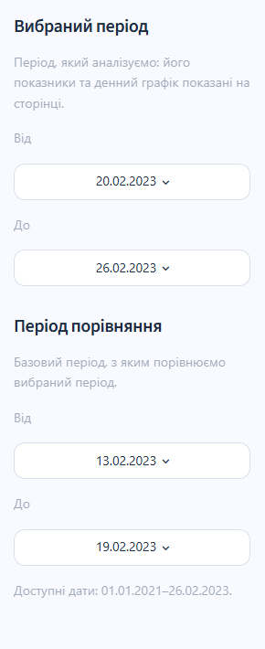
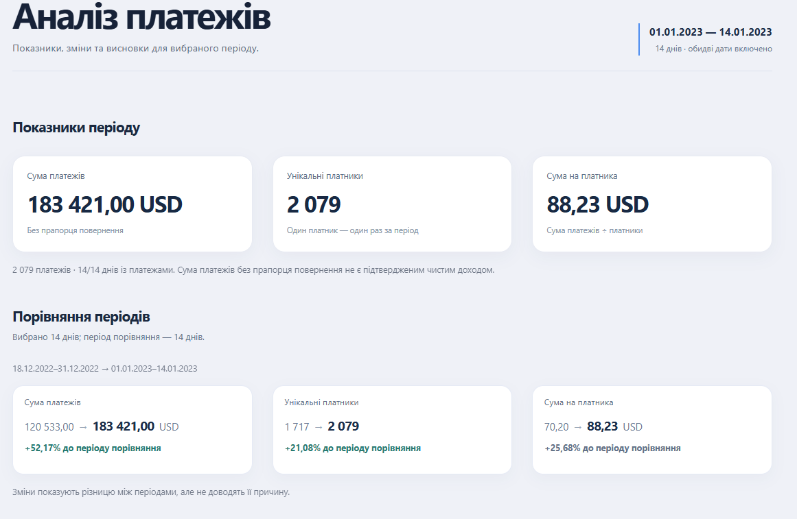
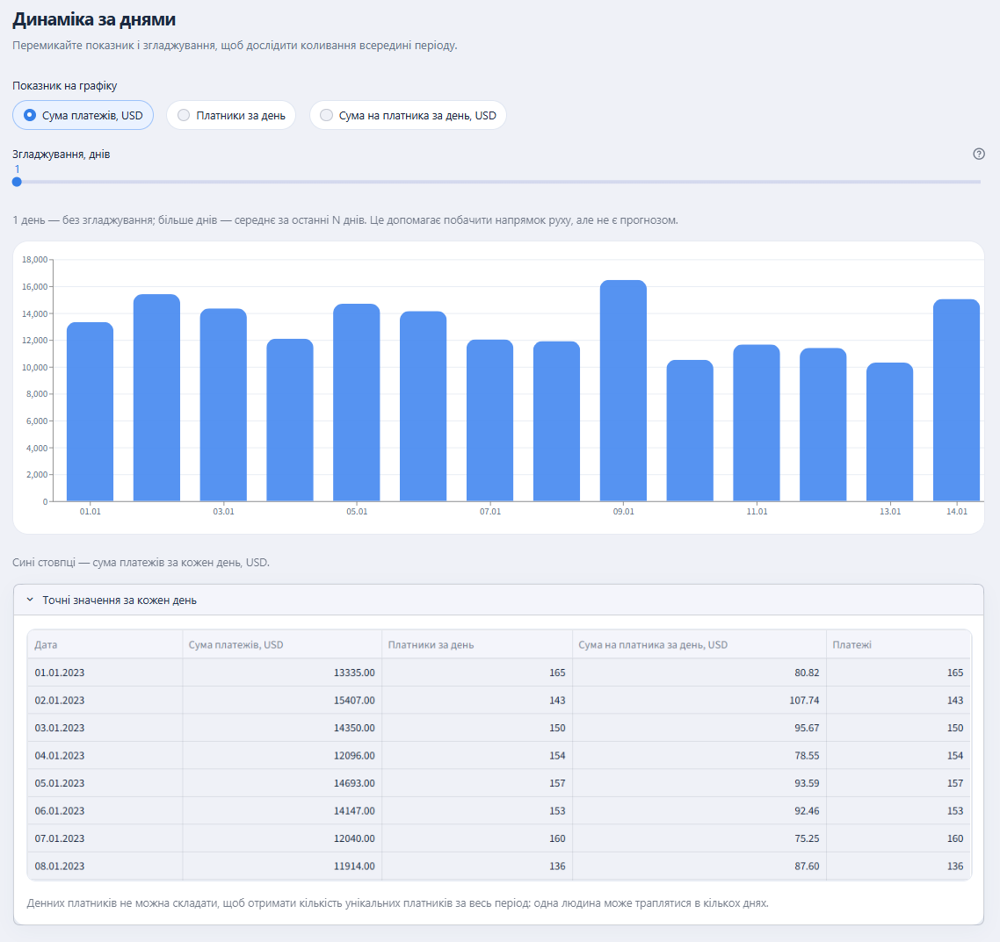
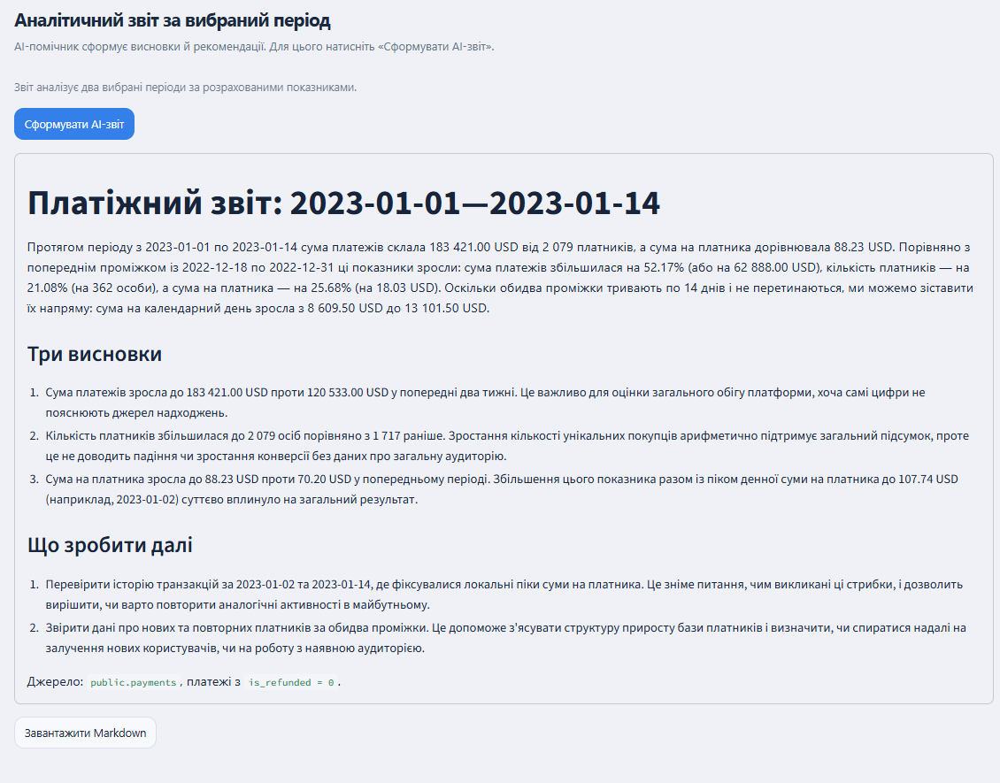

# Аналіз платежів платформи онлайн-курсів

У цьому бізнес-сценарії команда платформи онлайн-курсів стежить за оплатами: чи змінилася загальна сума, скільки людей платили та яка сума припала на одного платника. Застосунок бере платежі з PostgreSQL, рахує ці показники за двома вибраними проміжками, показує денну динаміку й готує короткий звіт за допомогою Gemini.

Ми використовуємо історичний набір даних Coursera. За результатами аудиту остання дата платежу в ньому — **2023-02-26**. Початковий приклад порівнює два сусідні тижні в межах цього набору; ви можете вибрати інші дати. Цей репозиторій демонструє спосіб аналізу, а не поточні показники діючої платформи.

## Бізнес-сценарій

Аналітику потрібно обрати періоди, однаково відфільтрувати платежі, порахувати підсумки й пояснити різницю. Якщо робити це окремими запитами та вручну переносити цифри у звіт, легко змішати різні дати або визначення показників. Тут користувач задає два проміжки один раз. Програма застосовує той самий фільтр до обох, рахує зміни та передає готові числа моделі. Людина перевіряє висновки перед тим, як використовувати їх для рішення.

Такий підхід допомагає швидко побачити, чи зміна суми платежів супроводжувалася зміною кількості платників або суми на одного платника. Для пошуку причин потрібні додаткові дані: платежі самі по собі не показують, що відбувалося з реєстраціями, маркетингом чи активністю студентів.

## Показники

Для порівняння використовуємо три показники. Разом вони дають змогу відрізнити зміну загальної суми від зміни кількості людей, які платили:

| Показник | Визначення |
| --- | --- |
| Сума платежів | `SUM(amount_usd)` для рядків `public.payments` із `is_refunded = 0`. Це **не підтверджений чистий дохід**: дати фактичного повернення в таблиці немає. |
| Унікальні платники | `COUNT(DISTINCT user_id)` за той самий проміжок і з тим самим фільтром. |
| Сума на платника | Сума платежів / унікальні платники. Якщо платників немає, показник не визначений. Це не обов'язково середній чек однієї транзакції. |

Для кожного проміжку система окремо рахує підсумки, а потім абсолютні й відносні зміни. Можна порівняти навіть проміжки різної довжини. У такому разі загальні суми та кількість унікальних платників залежать і від кількості днів, тому додатково показано суму платежів на календарний день; порівняння не доводить причини змін. Проміжки можуть перетинатися, але інтерфейс попереджає, що частина платежів потрапляє до обох підсумків.

## Перевірка даних і обмеження

Під час аудиту `public.payments` перевірено 87 924 рядки. Не знайдено порожніх ключових полів, повторених `payment_id`, нульових або від'ємних сум. Одна пара платежів має однакові користувача, дату, план, суму й прапорець повернення, але різні ID; доказів помилки недостатньо, тому нічого не видаляли. Для 40 платежів немає відповідного рядка в `users`; через це вони не відкидаються з розрахунків за `payments`, але враховуються в показниках лише тоді, коли відповідають фільтру `is_refunded = 0`. Детальні робочі нотатки залишаються локально в `PROJECT_NOTES.md`.

Проєкт не змінює вихідну базу. Користувач запускає звіт кнопкою або з командного рядка; автоматичного розкладу й email-розсилки немає. Для самостійного запуску потрібні власні доступи до PostgreSQL і Gemini API. Локальні секрети та згенеровані звіти виключені з Git через [.gitignore](.gitignore).

## Як працює проєкт

1. [data_audit.py](data_audit.py) перевіряє структуру й якість даних; він не змінює PostgreSQL.
2. [metrics.py](metrics.py) виконує read-only SQL-запити для підсумків і денної динаміки.
3. [report_data.py](report_data.py) готує вже розраховані показники для моделі. Для довгих проміжків [llm_report.py](llm_report.py) групує денні значення перед запитом до Gemini, не змінюючи підсумок за весь проміжок.
4. [report_writer.py](report_writer.py) додає заголовок і коротку примітку про джерело в кінці звіту, а потім зберігає Markdown у локальній папці `reports/`. Кожен звіт отримує окреме ім'я файлу.
5. [app.py](app.py) дає незалежно вибрати дати аналізу й порівняння. У меню дат є лише роки, місяці та дні, для яких існують враховані платежі. Інтерфейс показує три показники, зіставлення періодів, денний графік із перемиканням метрики та згладжуванням, а також таблицю точних значень. Кнопка **«Сформувати AI-звіт»** окремо викликає Gemini, показує результат і дає завантажити Markdown. Зміна дат чи графіка сама по собі не викликає модель.

Gemini не отримує сирі рядки платежів або персональні ID. Модель формулює висновки та рекомендації з переданих показників; самі числові розрахунки виконуються в Python/PostgreSQL. Висновки про причини змін не вважаються доведеними без додаткових даних. Перед використанням AI-звіту для рішення його потрібно переглянути.

Для реалізації використано Python, PostgreSQL, `psycopg`, `pandas`, Altair і Streamlit. До Gemini програма звертається через `google-genai`; поточна локальна конфігурація задає модель `gemini-3.5-flash-lite` у `GEMINI_MODEL`. `python-dotenv` читає налаштування з локального `.env`. Готовий текст програма зберігає у Markdown.

## Структура репозиторію

```text
FP_00/
├── .streamlit/config.toml  # кольори інтерфейсу
├── deploy/                 # приклади конфігурацій служби та зворотного проксі
├── docs/images/            # скриншоти для цього README
├── tests/test_project.py   # перевірки розрахунків і створення звіту
├── .env.example            # назви потрібних змінних без ключів і паролів
├── .gitignore              # захист локальних файлів від випадкового коміту
├── AGENTS.md               # правила роботи з кодом і даними
├── app.py                  # інтерфейс Streamlit
├── data_audit.py           # аудит джерела без зміни таблиць
├── llm_report.py           # інструкція та запит до Gemini
├── metrics.py              # SQL-запити й три показники
├── report_data.py          # порівняння та дані для Gemini
├── report_writer.py        # створення Markdown-звіту
├── PRESENTATION.md         # сценарій показу застосунку
├── README.md               # опис проєкту й запуск
└── requirements.txt        # Python-залежності
```

Локальні `.env`, `.venv/`, `.vscode/`, `reports/` і `PROJECT_NOTES.md` не входять до репозиторію. Програма створює `reports/` під час збереження першого звіту. Скріншоти в `docs/images/` не містять ключів або персональних ID.

## Запуск локально

Цей розділ для тих, хто завантажив репозиторій і хоче запустити застосунок на своєму комп'ютері. Для перегляду коду та скриншотів нічого встановлювати не потрібно.

Для роботи застосунку потрібні Python 3.12, власний доступ до PostgreSQL із таблицею `public.payments` і ключ Gemini API. Цих доступів у репозиторії немає.

1. Відкрийте PowerShell у папці проєкту. Створіть Python-оточення та встановіть залежності:

   ```powershell
   python -m venv .venv
   .\.venv\Scripts\python.exe -m pip install -r requirements.txt
   ```

2. Скопіюйте `.env.example` у файл `.env` і впишіть туди свої `PGHOST`, `PGDATABASE`, `PGUSER`, `PGPASSWORD`, `GEMINI_API_KEY` та `GEMINI_MODEL`. Якщо `.env` уже існує, не перезаписуйте його. `PGPORT` і `PGSSLMODE` додайте лише за потреби для вашого підключення. Не публікуйте `.env` у GitHub.

3. Запустіть застосунок:

   ```powershell
   .\.venv\Scripts\python.exe -m streamlit run app.py
   ```

Streamlit покаже в терміналі локальну адресу. Відкрийте її у браузері.

Перевірити розрахунки без бази даних і Gemini можна так:

```powershell
.\.venv\Scripts\python.exe -m unittest discover -s tests -v
```

## Інтерфейс

### 1. Вибір дат



У бічній панелі ви задаєте дати аналізу та базовий проміжок для порівняння. Кожен проміжок має початок і кінець; програма включає обидві дати. Меню пропонує дати, за які є враховані платежі. На знімку показано два сусідні 14-денні проміжки; кнопки швидкого вибору на ньому залишилися від попередньої версії інтерфейсу. Початкові налаштування застосунку показують порівняння двох сусідніх 7-денних проміжків.

### 2. Показники та порівняння



Верхні картки показують суму платежів, кількість різних платників і суму платежів на одного платника за вибраний проміжок. Нижні картки ставлять поруч значення базового та вибраного проміжків і показують відсоток зміни. У прикладі 01–14.01.2023 порівняно з 18–31.12.2022 сума зросла зі 120 533 до 183 421 USD (+52,17%), кількість платників — з 1 717 до 2 079 (+21,08%), а сума на платника — з 70,20 до 88,23 USD (+25,68%). Це опис змін, а не пояснення їхніх причин.

### 3. Денна динаміка



Перемикач над графіком обирає суму платежів, платників за день або суму на платника за день. Сині стовпці показують денне значення вибраного показника; для суми на платника програма малює лінію. Повзунок згладжування додає помаранчеву лінію ковзного середнього за останні N днів. Значення «1 день» залишає лише фактичні точки. Під графіком таблиця дає точні денні числа. Денних унікальних платників не можна додавати, щоб отримати кількість платників за весь проміжок: одна людина могла платити в різні дні.

### 4. AI-звіт і Markdown



Після натискання «Сформувати AI-звіт» програма передає Gemini розраховані показники за двома періодами та денну динаміку. Модель пише короткий звіт із порівнянням, трьома висновками й рекомендаціями. Застосунок показує текст на сторінці та зберігає окремий Markdown-файл у папці `reports/` на машині, де він запущений. Кнопка «Завантажити Markdown» дає користувачу завантажити копію звіту.

## Як застосунок допомагає аналізувати платежі

Він збирає показники за два обрані проміжки в одному місці. Замість ручного зіставлення таблиць аналітик одразу бачить, як змінилися сума платежів, кількість платників і сума на одного платника, а потім може перевірити висновки у звіті.

### 1. Які бізнес-показники обрали та чому?

**Сума платежів** показує загальний обсяг оплат за вибраний проміжок. **Унікальні платники** показують, скільки різних людей платили. **Сума на платника** допомагає побачити, як змінився обсяг оплат у розрахунку на одну людину. Разом ці три показники дають зрозуміти арифметику зміни загальної суми, але не пояснюють поведінку платників.

### 2. Які інструменти використали?

PostgreSQL зберігає історичні платежі, Python і SQL рахують показники. Streamlit показує вибір дат, картки та таблицю, а Altair будує графік. Gemini `3.5 Flash-Lite` отримує вже розраховані числа й формулює висновки. Звіт зберігається у Markdown.

### 3. Як працює рішення?

Користувач вибирає два проміжки. Програма бере платежі без прапорця повернення, рахує показники для кожного проміжку та показує різницю в числах і відсотках. Графік і таблиця допомагають перевірити денну динаміку. Після натискання «Сформувати AI-звіт» Gemini готує три висновки й пропонує подальші перевірки. Звіт можна завантажити як Markdown-файл.

### 4. Які висновки отримали з даних?

На скриншотах вище вибрано 01–14.01.2023 і попередній 14-денний проміжок 18–31.12.2022. Саме для цих дат наведено підсумки нижче. Початкові налаштування застосунку окремо показують два послідовні 7-денні тижні.

| Показник | 18–31.12.2022 | 01–14.01.2023 | Зміна |
| --- | ---: | ---: | ---: |
| Сума платежів | 120 533 USD | 183 421 USD | +62 888 USD (+52,17%) |
| Унікальні платники | 1 717 | 2 079 | +362 (+21,08%) |
| Сума на платника | 70,20 USD | 88,23 USD | +18,03 USD (+25,68%) |

У січневому проміжку сума платежів була вищою на 62 888 USD. Платників стало на 362 більше, а сума на одного платника зросла на 18,03 USD. Ці три зміни видно в розрахунках, але вони не пояснюють, чому люди платили інакше.

Наступний крок: розділити платежі за тарифами й перевірити, чи змінився склад оплат між проміжками. Щоб говорити про залучення або відтік, потрібні також дані про реєстрації та активність користувачів. Для усного показу є короткий [сценарій демонстрації](PRESENTATION.md).
